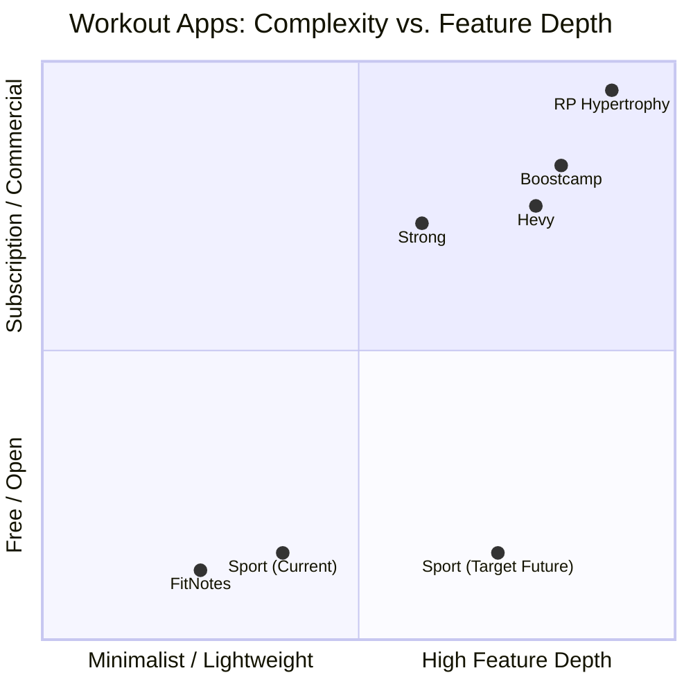
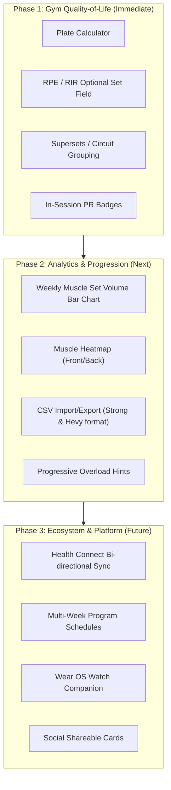

# Sport App: Feature Analysis & Competitive Benchmark

A comprehensive evaluation of the **Sport Android** application compared to the industry's leading workout tracking and fitness platforms (Hevy, Strong, RP Hypertrophy, Boostcamp, FitNotes, Caliber, and Strava).

---

## 1. Executive Summary

**Sport** is a clean, modern, privacy-focused fitness application built with Jetpack Compose, tactile neumorphic design, and Kotlin 2.0. It bridges personal workout journaling, structured routine management, exercise library browsing, and body metric tracking with multi-language support (EN, DE, ES, FR, IT) and Firebase backend sync.

While the app excels in **simplicity, speed, offline-first reliability, aesthetics, and zero paywalls**, top-tier commercial trackers (such as Hevy, Strong, and RP Hypertrophy) provide specialized training tools (RPE/RIR tracking, supersets, plate calculators, muscle recovery heatmaps, multi-week program progression, and Health Connect sync) that elevate the lifting experience.

---

## 2. Current App Feature Inventory

The following table itemizes what is currently implemented and functional in the Sport Android app:

| Domain | Implemented Features |
| :--- | :--- |
| **Authentication & Profile** | Email/password sign-in, Google Sign-in with Credential Manager, anonymous guest mode, personal metrics (height, birth year, bio notes). |
| **Dashboard** | Streak tracker (current week days active), lifetime summary (total workouts, total volume, active minutes), current body weight stat, quick-start favorite routines list, recent workouts list with trained body parts breakdown. |
| **Workout Logging** | Live elapsed timer with persistent background indicator banner (freely navigate app while workout runs), routine loading, ad-hoc empty workouts, add/remove exercises, add/remove sets, set types (Normal, Warmup, Drop Set, Failure), auto-fill weights & reps from previous workouts, rest timer with haptic buzz, 1-5 star workout intensity rating, session comments, auto-recorded duration in minutes. |
| **Workout Details & History** | Chronological journal, workout cards with volume, duration, exercise counts, set breakdowns, full edit and delete capabilities. |
| **Routine / Template Management** | Multi-exercise templates, target sets/reps/weight, favorites starring, fast launch into active workout, subtle card controls, routine edit and delete. |
| **Exercise Library** | Exercise database categorized by **Body Part**, **Exercise Type** (Strength, Cardio, Flexibility, Other), and **Equipment** (Barbell, Dumbbell, Machine, Cable, Bodyweight, Kettlebell). Full multi-filter carousel, keyword & alias search, custom exercise creation. |
| **Exercise Detail & Analytics** | Hero header with category badges, personal cues/notes with local & cloud persistence, external resource links with in-app browser launch, date & relative time of last trained session, PR banner (All-time Max Weight & Est. 1RM), interactive Compose Canvas progress chart with 1M/3M/6M/1Y/All timeframes. |
| **Body Metrics Tracking** | Weight logging, body fat percentage, circumference measurements (waist, hips, chest, shoulders, biceps, thighs), interactive Body Metrics Chart (Weight, BMI, Body Fat % over time), dedicated history log. |
| **Settings & Personalization** | Dedicated Settings screen, Theme mode (System, Light, Dark), Language mode (EN, DE, ES, FR, IT), switches for Autofill, Rest Timer, and Workout Duration tracking, Account Sign Out. |
| **Design System** | Tactile neumorphic elevation, brand color gradient (`#7E388D` $\rightarrow$ `#B8285A`), accessible Material 3 components, zero external charting dependencies (native Canvas Bézier charts). |

---

## 3. Competitive Comparison Matrix

Comparing **Sport** with the benchmark applications in strength & fitness:
- **Hevy**: Current gold standard for gym tracking + social community.
- **Strong**: Clean, veteran workout tracker with plate calculator & Apple/Wear OS apps.
- **RP Hypertrophy (Renaissance Periodization)**: Science-based progressive overload, RIR auto-regulation, fatigue management.
- **FitNotes**: Beloved offline, lightweight Android tracker with raw logging speed.
- **Boostcamp**: Program-first coaching platform (GZCLP, nSuns, 5/3/1).

| Feature Capability | Sport (Current) | Hevy | Strong | RP Hypertrophy | FitNotes | Boostcamp |
| :--- | :---: | :---: | :---: | :---: | :---: | :---: |
| **Free / No Paywall** | **100% Free** | Freemium | Freemium | \$30/mo | Free | Freemium |
| **Ad-Free Experience** | **Yes** | Yes (Pro) | Yes (Pro) | Yes | Yes | Yes (Pro) |
| **Multi-Language (5 Locales)** | **Yes** | Yes | Yes | English only | Partial | English only |
| **Live Workout Timer & Banner** | **Yes** | Yes | Yes | Yes | No | Yes |
| **Auto-fill Previous Sets** | **Yes** | Yes | Yes | Yes | Yes | Yes |
| **Set Tags (Warmup, Drop, Failure)** | **Yes** | Yes | Yes | Yes | No | Yes |
| **RPE / RIR Tracking** | **Missing** | Yes | Yes (Pro) | **Core** | No | Yes |
| **Plate Calculator** | **Missing** | Yes | Yes | No | Yes | Yes |
| **Supersets & Giant Sets** | **Missing** | Yes | Yes | No | No | Yes |
| **Warmup Calculator** | **Missing** | Yes | Yes | No | No | No |
| **Muscle Recovery / Heatmap** | **Missing** | Yes | No | Yes | No | No |
| **Weekly Volume per Muscle Group** | **Missing** | Yes (Pro) | No | Yes | No | Yes |
| **Multi-Week Structured Programs** | **Missing** | Routines only | Routines only | Periodized | No | **Core** |
| **Exercise Substitution Suggester** | **Missing** | No | No | Yes | No | Yes |
| **Health Connect / Wear OS Sync** | **Missing** | Yes | Yes | No | No | Yes |
| **CSV Import & Export (Strong/Hevy)**| **Missing** | Yes | Yes | No | Yes | No |
| **Shareable Workout Graphic (Social)**| **Missing** | Yes | Yes | No | No | Yes |
| **In-Workout PR Audio / Badge Pop** | **Missing** | Yes | Yes | No | Yes | Yes |

---

## 4. Key Gaps & Missing Features

### A. Core Workout Tracking & In-Gym Utilities (High Impact)

1. **RPE / RIR (Rate of Perceived Exertion / Reps In Reserve) Logging**
   * *What it is*: Allows lifters to log how many reps they had left in the tank (e.g. RIR 2 / RPE 8) per set.
   * *Why it matters*: Modern evidence-based training relies on RIR/RPE to manage fatigue and ensure progressive overload without overtraining.
   * *Implementation*: Optional column next to Weight and Reps in set rows.

2. **Barbell Plate Calculator**
   * *What it is*: A visual modal that tells the lifter exactly which plates (25kg, 20kg, 15kg, 10kg, 5kg, 2.5kg, 1.25kg) to load on each side of the bar.
   * *Why it matters*: Eliminates mental math fatigue between heavy working sets, with configurable bar weight (20kg Olympic, 15kg women's, 10kg trap bar, or custom kg/lbs).

3. **Supersets & Circuit Grouping**
   * *What it is*: Visually link two or more exercises (e.g. Bicep Curls + Tricep Pushdowns or Bench Press + Bent Over Rows) with colored connector bands and shared rest timers.
   * *Why it matters*: Time-efficient gym workouts frequently use antagonist supersets.

4. **Warm-up Set Auto-Calculator**
   * *What it is*: Given a target working weight (e.g. 100 kg), automatically generates warmup sets (e.g. Empty bar x 10, 50kg x 5, 70kg x 3, 85kg x 1).

5. **In-Session Personal Record (PR) Celebrations**
   * *What it is*: Instant visual badge ("New 1RM Record!", "Volume PR!") and optional haptic chime when checking off a set that exceeds prior records.

---

### B. Progression & Program Intelligence

6. **Multi-Week Programs & Mesocycles**
   * *What it is*: Going beyond single-day routines into structured multi-week training programs (e.g., Week 1 to 6 with built-in deload weeks, target volume increases, or percentage-based loading schemes).
   * *Reference*: Boostcamp & RP Hypertrophy.

7. **Smart Progressive Overload Hints**
   * *What it is*: When loading an exercise, display recommendations: *"Last session: 80 kg × 3×10. Target today: 82.5 kg × 8-10 or 80 kg × 11."*

8. **Alternative Exercise Suggester**
   * *What it is*: If equipment is occupied (e.g., Lat Pulldown machine taken), suggest direct biomechanical equivalents (Pull-ups, Single-arm Cable Pulldown, Chest-Supported Row).

---

### C. Analytics, Visualizations & Recovery

9. **Anatomical Muscle Recovery Heatmap**
   * *What it is*: A 2D front/back body diagram showing muscle recovery state (fresh, recovering, fatigued) calculated from recently logged sets and elapsed hours.

10. **Weekly Sets per Muscle Group (Hypertrophy Tracker)**
    * *What it is*: Bar chart showing total weekly hard sets per muscle group (e.g., Chest: 14 sets, Back: 16 sets, Quads: 12 sets) compared against optimal volume landmarks (Minimum Effective Volume vs Maximum Recoverable Volume).

11. **1RM Calculator Tool & Percentage Breakdown Table**
    * *What it is*: Dedicated utility screen where lifters input weight and reps to see estimated 1RM across formulas (Epley, Brzycki, Wathan) and standard training percentages (95%, 90%, 85%, 80%, 75%, 70%).

---

### D. Ecosystem, Connectivity & Data Ownership

12. **Health Connect Sync (Android 14+ / Google Play Services)**
    * *What it is*: Bi-directional sync with Android Health Connect. Syncs completed workouts, duration, calories, and body weight to Google Fit, Samsung Health, Garmin, and Fitbit.

13. **CSV Data Import & Export (Strong / Hevy / FitNotes format)**
    * *What it is*: One-click CSV backup and import. Allows users migrating from Strong or Hevy to bring their multi-year training histories directly into Sport without data loss.

14. **Wear OS Companion App**
    * *What it is*: Minimal watch app allowing set completion check-off, weight/reps adjustments, and wrist vibration for rest timers without touching the smartphone.

15. **Shareable Visual Workout Summary Card**
    * *What it is*: Generates a clean, branded social media image (Instagram story / message card) summarizing completed workout stats, top lifts, and PRs.

---

## 5. Strategic Roadmap Recommendations

### Top 3 Quick-Win Recommendations for Immediate Development:
1. **Plate Calculator**: Extremely popular utility with zero backend changes required; pure Compose UI dialog accessible right from the set row or top app bar.
2. **RPE / RIR Logging**: Minimal schema addition to `ExerciseSet` (`rpe: Double?`), immediately brings the app up to modern powerlifting & bodybuilding standards.
3. **CSV Export / Import (Strong & Hevy format)**: Unlocks instant user migration from incumbent paid apps without friction.
